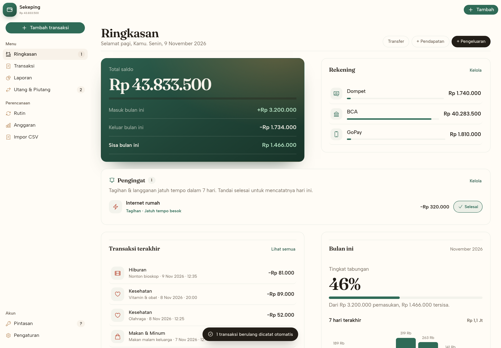
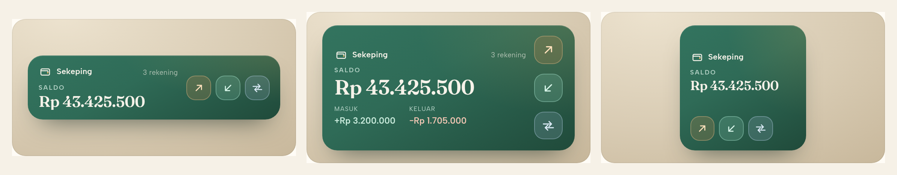
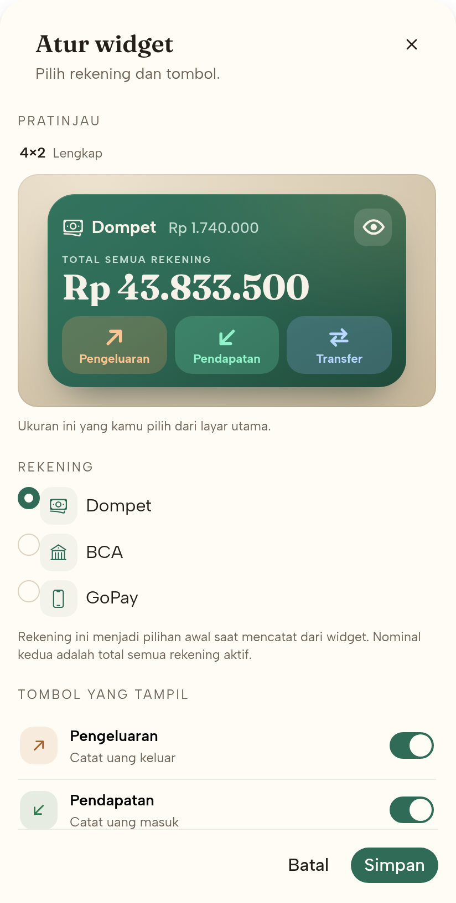
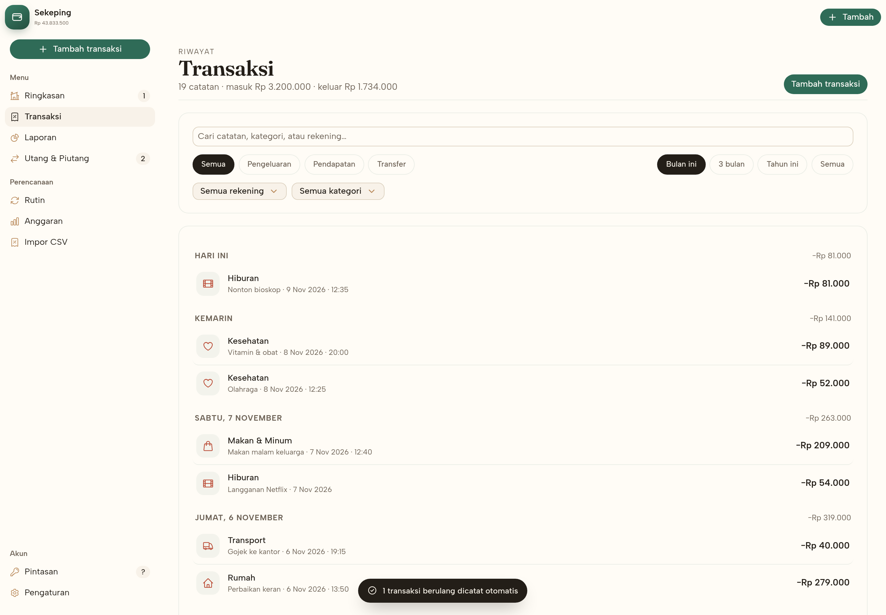
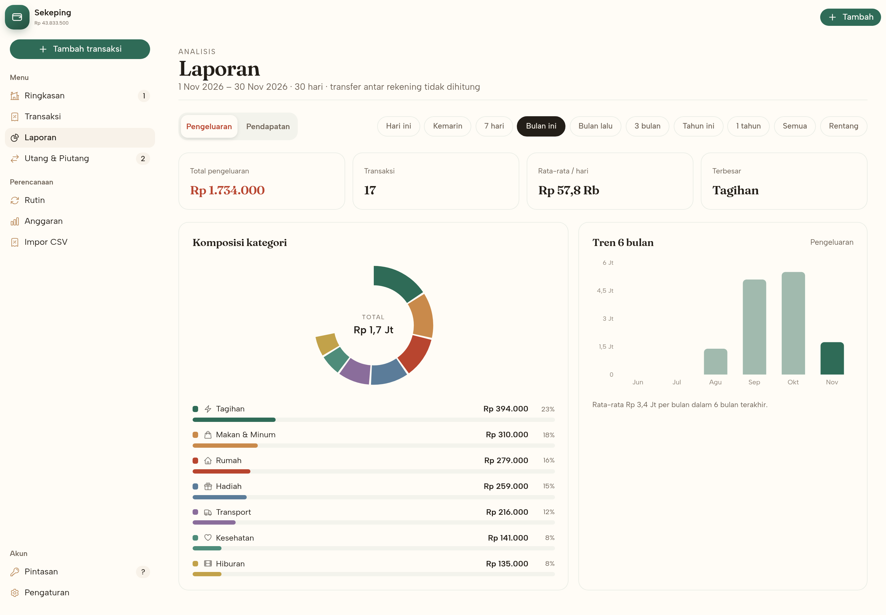
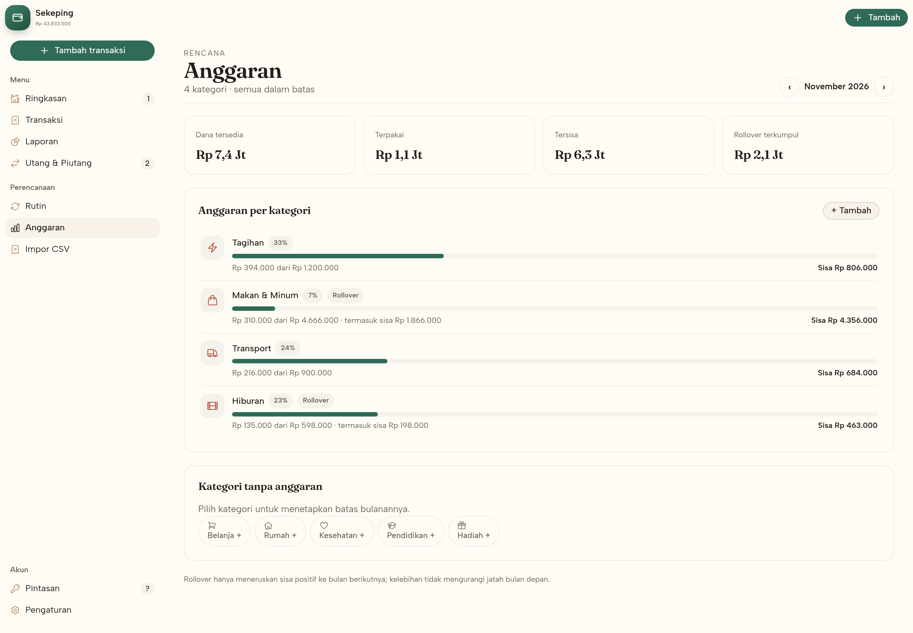
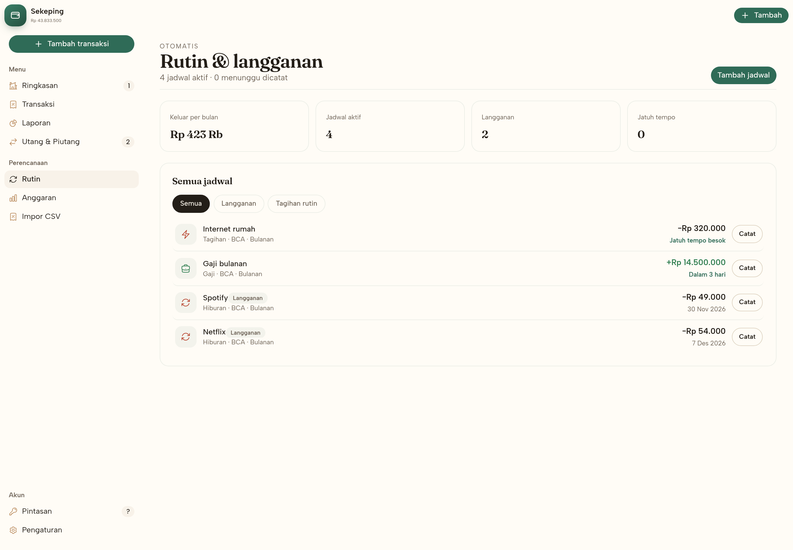
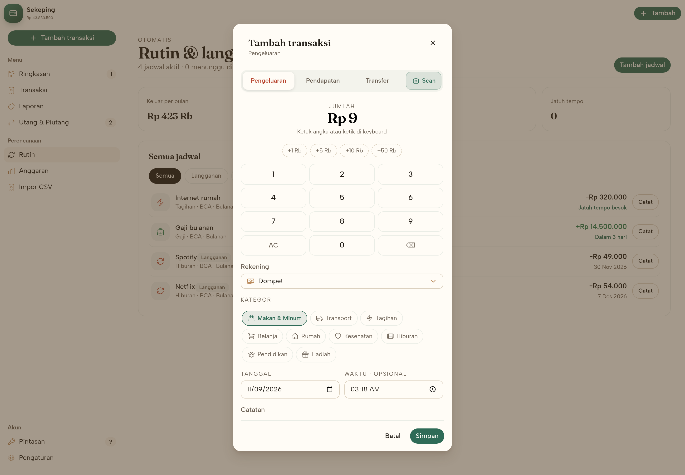
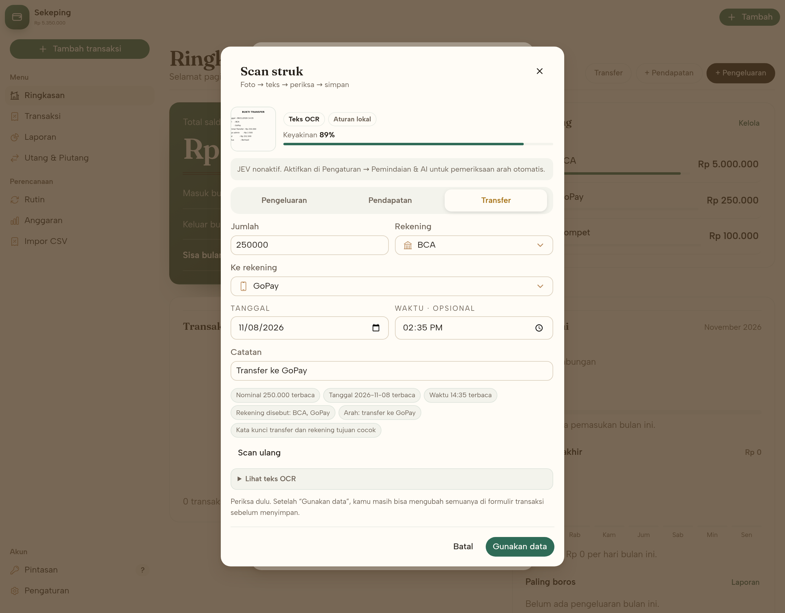
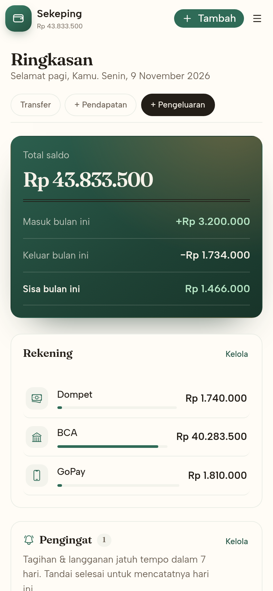

<p align="center">
  
</p>

<h1 align="center">Sekeping</h1>

<p align="center"><strong>A calm personal-finance web app.</strong><br>
Track accounts, spending, transfers, reports, debts and receivables — in the browser, with no sign-up and no server.</p>

<p align="center">
  <a href="LICENSE"></a>
  
  
  <a href="CONTRIBUTING.md"></a>
</p>

<p align="center">
  <a href="#quick-start">Quick start</a> ·
  <a href="#usage">Usage</a> ·
  <a href="#screenshots">Screenshots</a> ·
  <a href="#how-it-works">How it works</a> ·
  <a href="#contributing">Contributing</a>
</p>

<p align="center">
  
</p>

## About

Sekeping (*a coin*, in Indonesian) is a local-first notebook for your money. Most
finance apps ask you to create an account, sync to a cloud, and hand over your spending
history. Sekeping does the opposite: it is a static site, the data lives in your
browser's `localStorage`, and nothing is uploaded anywhere. Receipt OCR runs on the
device; the optional JEV check sends only the OCR text, and only after you turn it on.

It is built for people who want a fast, quiet ledger — a few accounts, daily expenses,
the occasional transfer, a monthly report, and a reminder of who owes whom.

**What makes it different**

- **Zero backend.** Clone it, build it, host it on any static host. No database, no auth service.
- **Instant.** One small bundle, self-hosted fonts and OCR data, no third-party calls after load.
- **Yours.** Export everything to CSV or a JSON backup at any time; restore it on another device.
- **Complete enough.** Accounts, categories, transfers with fees, recurring bills and subscriptions,
  rolling budgets, reports, CSV import, password-encrypted backups, debts, loans, a PIN lock —
  and a receipt scanner that reads a photo, checks where the money goes, then asks you to confirm.

## Features

| Area | What you get |
| --- | --- |
| **Dashboard** | Total balance across active accounts, monthly in/out, saving rate, 7-day spend chart, recent activity, top categories, and a seven-day reminder for bills and subscriptions with one-tap **Selesai** |
| **Transactions** | Search, filter by type / account / category / period, grouped by day with daily totals and ordered by date + time, detail view with edit and delete |
| **Entry** | Expense, income, transfer or **Scan**; amount pad (keyboard too) with cents-first entry and **Clear all**, account picker with icons, category picker, date, optional time, note, transfer fee |
| **Receipt scan** | Photo → on-device OCR (Tesseract.js, Indonesian + English) → editable confirmation with amount, type, source/destination account, category, date, time and note; optional free **JEV** check on OpenCode Zen to verify the direction; nothing is saved until you press **Gunakan data** and then **Simpan** |
| **Reports** | Category donut, ranked category bars, six-month trend, expense/income toggle, quick ranges (**Hari ini, Kemarin, 7 hari, Bulan ini, Bulan lalu, 3 bulan, Tahun ini, 1 tahun, Semua**) and a custom **from/to date range** |
| **Recurring** | Weekly, monthly or yearly schedules for bills, salary and subscriptions; catch-up posting on open; monthly subscription cost |
| **Budgets** | Monthly limit per expense category, optional rollover of unused money, month-by-month progress and over-budget warnings |
| **Import** | CSV from a bank or another app with column mapping, date/amount format detection, duplicate skipping and optional account/category creation |
| **Debts & receivables** | Paid vs remaining progress, due dates, overdue state, payment entries that post to the ledger |
| **Settings** | Profile and currency, account and category CRUD with icon picker, PIN lock, CSV export, CSV import, JSON backup, password-encrypted backup, demo reset |
| **Keyboard** | Skip link, arrow-key menus, `Alt+1…6` page jumps, `g`-prefix jumps, `n` for a new expense, `?` for the shortcut sheet |
| **Responsive** | Sidebar and top bar on desktop; drawer navigation and a top action bar on phones |
| **Android app** | Offline APK plus 4×1 / 4×2 / 2×2 home-screen widgets chosen directly from the launcher's widget picker: the chosen provider and its balance, the total of all accounts, an eye that masks amounts with `***`, and three large icon-only quick actions (see [Android app](#android-app)) |
| **Design** | One Astryx frame, one panel rhythm and one type scale on every screen (see [Design](#design)) |

## What's new in 1.2

- **Receipt scanner in the entry pad.** The type row is now **Pengeluaran · Pendapatan ·
  Transfer · Scan**. Pick a photo and Tesseract.js reads it on the device.
- **A confirmation screen before anything is saved.** Type, amount, source account,
  destination account, category, date, time and note are all editable; the OCR text and a
  confidence score sit beside them. **Gunakan data** fills the normal form, then **Simpan**
  writes the transaction.
- **Optional free JEV check.** When enabled, the free `jev-1.13-free` decision model on
  OpenCode Zen reviews the OCR text and says where the money went (expense / income /
  internal transfer), plus the likely source, destination and category. Amount and date
  remain local. A CORS proxy path is included for static hosting.
- **Bundled OCR runtime.** The worker, LSTM WebAssembly cores and Indonesian + English
  models ship with the app; no CDN request, and the APK keeps the same offline scanner.

## Quick start

### Run it locally

```bash
git clone https://github.com/shabriafrizal/sekeping.git
cd sekeping
npm install
npm run dev
```

Open the printed URL (usually <http://localhost:5173>). The ledger starts **empty**; the
start screen lets you pick a language and currency and offers a demo dataset if you want
to explore first.

**Requirements:** Node.js 20 or newer, npm 10 or newer, and any modern browser.

### Use the hosted build

**<https://shabriafrizal.github.io/sekeping/>** — served by GitHub Pages from the
`gh-pages` branch. To publish your own copy, see [Deploy](#deploy).

## Android app

The same build ships as an APK with an offline WebView and a home-screen widget.

### Install

1. Download **[sekeping-1.2.0.apk](https://github.com/shabriafrizal/sekeping/releases/download/v1.2.0/sekeping-1.2.0.apk)** (11 MB) or browse [Releases](https://github.com/shabriafrizal/sekeping/releases).
2. Open it on the phone and allow installs from this source when prompted.
3. Requires Android 7.0 (API 24) or newer. It works offline; no account needed.

### Use the widget

1. Long-press an empty spot on the home screen → **Widgets**.
2. Find **Sekeping** and choose the size you want up front: **Sekeping 4×1**,
   **Sekeping 4×2** or **Sekeping 2×2**.
3. The **Atur widget** dialog opens with a live preview of that size. Pick the
   **default account** and which quick buttons to show. Long-press the widget →
   **Reconfigure** to change it later.
4. The widget shows the **provider** you picked (icon and name) with its own balance, and
   the **total** of every active account. Tap the **eye** to mask both amounts with `***`;
   tap it again to show them. Each entry keeps its size:
   - **4×1** — provider, its balance and the total in one column, with three large icon buttons beside them.
   - **4×2** — provider and eye on top, balance and the total as the hero figure, with three large icon buttons across the bottom.
   - **2×2** — provider, balance and total stacked, with three icon buttons along the bottom.

   The buttons carry only bold icons; their names are kept for screen readers. The widget uses
   the phone's default system font, bold for names and amounts, and the text shrinks to fit
   each size on Android 8.0 and newer.
5. **Pengeluaran**, **Pendapatan** and **Transfer** do not open the dashboard. They show
   the same add-transaction sheet as the app, floating over the home screen, with the
   chosen account already selected. Save or cancel returns straight to the home screen;
   if a PIN is set, the sheet asks for it first.





### Build the APK

```bash
ANDROID_HOME=/path/to/android-sdk ./scripts/build-apk.sh
```

Requires JDK 17+, Android SDK platform 34 and build-tools 34.0.0. The script builds the
web app, bundles `dist/` into the APK, and writes
`android/app/build/outputs/apk/release/app-release.apk`. Details in
[`android/README.md`](android/README.md).

The APK keeps its own ledger in the WebView's storage — separate from the hosted site —
and it disappears when the app is uninstalled. Use **Pengaturan → Data → Cadangkan JSON**
to move data between the two.

## Usage

### Record a transaction

1. Press **Tambah transaksi** in the sidebar, or **Tambah** in the top bar on a phone.
2. Choose **Pengeluaran**, **Pendapatan** or **Transfer**.
3. Type the amount with the pad, or just type the digits on your keyboard. For currencies
   with cents it starts at `0,00` and every digit shifts in from the right (`1`, `2`, `5`
   → `1,25`); **AC** clears everything. The account picker shows each account's icon.
4. Pick an account and a category. The date defaults to today and the time to now;
   clear the time to record the entry without one.
5. Then **Simpan**.

Every entry has a date and an optional time. Lists sort by that moment (newest first),
so two expenses on the same day keep the order you recorded them in.

### Scan a receipt

1. Open **Tambah transaksi** and press **Scan**, the button to the right of **Transfer**.
2. Pick a photo from the gallery or camera, or drop it on the panel. OCR runs locally with
   Tesseract.js and its Indonesian + English models, so the image never leaves the device.
3. When the text is read, the **Scan struk** dialog becomes a confirmation screen. Check the
   amount, **Pengeluaran / Pendapatan / Transfer**, source account, destination account,
   category, date, time and note. Every field is editable — OCR rarely gets a receipt perfect
   the first time.
4. Press **Gunakan data**. The values move into the normal transaction form, where you can
   change them again, then press **Simpan**. Nothing is written to the ledger before that.

If the photo is unreadable, **Tempel teks manual** accepts copied receipt text. The OCR
raw text is always available under **Lihat teks OCR**. A confidence bar and short signals
show which parts were found (amount, date, account, category).

The scanner is deliberately conservative about the amount: it prefers **Nominal Transfer**
over **Total** when a transfer receipt also lists an admin fee, and it ignores balances,
cash paid and change. If it guesses wrong, correct it before saving.

#### Optional JEV check

The free **jev-1.13-free** model on [OpenCode Zen](https://opencode.ai/docs/zen/) is a
decision model, not a chat model: it answers typed questions about the OCR text, such as
“is this expense, income or an internal transfer?”, “which account did it leave?”, “which
account did it go to?” and “which category fits?”. The amount, date and time still come
from the local parser, so JEV cannot invent a number.

Enable it in **Pengaturan → Pemindaian & AI**. Only the OCR text and your account/category
names are sent; the photo is not. If JEV is unavailable, the scan still works with local
rules and says so on the confirmation screen.

OpenCode Zen does not answer browser CORS preflights on its public endpoint. The app
handles that in two ways:

- **Local development** — `npm run dev` already proxies `/api/jev` to OpenCode. The field
  can stay at `/api/jev`.
- **Static hosting** — deploy the small Worker in [`worker/jev-proxy.js`](worker/jev-proxy.js)
  (`cd worker && npx wrangler deploy`) and paste its URL into **URL JEV / proxy**. The Worker
  holds no key; the free model is keyless. `npm run proxy` starts the same proxy locally on
  `http://127.0.0.1:4178` if you prefer a separate process.

If the free tier returns 429, the confirmation screen keeps the local result and explains
the limit. Turn the switch off to keep everything on-device.

### Move money between accounts

Choose **Transfer**, set the source and destination account and, if your bank charges
one, the admin fee. Transfers never count as income or spending in reports.

### Read your month

**Laporan** shows a category donut and a ranked list for the selected period, plus a
six-month trend. Toggle between spending and income at the top. Pick a shortcut — **Hari
ini**, **Kemarin**, **7 hari**, **Bulan ini**, **Bulan lalu**, **3 bulan**, **Tahun ini**,
**1 tahun**, or **Semua** — or choose **Rentang** for an exact `Dari`/`Sampai` span. The
date fields remember the last shortcut, so Rentang starts from it. Pick the same day on
both sides to inspect a single day. The header shows the effective dates and the average
KPI is per day for any finite range.

### Track debts and loans

**Utang & Piutang** keeps both sides of a loan: what you owe and what you are owed.
Each card shows the remaining amount, a progress bar and the due date. Recording a
payment creates a matching transaction, so the ledger and the debt record stay in sync.

### Automate recurring bills

**Rutin** holds schedules for rent, salary, bills and subscriptions. Pick the account,
category and interval (weekly, monthly or yearly) and the first due date. When the app
opens on or after a due date it writes the transaction automatically and catches up on
missed occurrences. You can also press **Catat** to post one early, or **Lewati sekali**
to skip an occurrence. Marking an item as a subscription adds it to the monthly cost
summary.

### Answer the reminders on Ringkasan

Bills and subscriptions due within the next seven days appear in the **Pengingat** card on
Ringkasan, together with the days left and the amount. Press **Selesai** to post the
expense dated today and move the schedule to its next occurrence; the item disappears
from the card and the count on the Ringkasan menu clears. Anything overdue is marked in
red, and **Kelola** jumps to the full schedule list.

### Set budgets that roll over

**Anggaran** sets a monthly limit per expense category. A progress bar shows spending
against the limit, and rows turn red when you pass it. With **rollover** on, money you
did not spend is added to next month's allowance — overspending never shrinks the next
month. Switch months with the arrows to look back.

### Import a CSV

1. Open **Pengaturan → Data → Impor CSV** (or press `g` then `i`).
2. Choose a file, or paste the CSV text.
3. Match each field to a column. Sekeping guesses the usual headers (`Tanggal`,
   `Jumlah`, `Kategori`, …) and accepts `,`, `;`, tab or `|` separators.
4. Pick the default type and the date order; turn on **Arah dari tanda angka** when
   negative amounts mean spending.
5. Check the preview, then import. Duplicates are skipped and unfamiliar accounts or
   categories can be created on the spot.

### Language and currency

**Pengaturan → Profil** sets two things:

- **Bahasa** — Bahasa Indonesia (default) or English. It translates the whole interface
  (pages, dialogs, toasts, empty states) and drives number and date formatting plus the
  widget labels, including the setup dialog.
- **Mata uang** — IDR (default), USD, EUR, SGD or MYR. It changes the symbol and grouping
  everywhere, including the widget.

Both can also be chosen on the welcome screen, with a live sample of the formatted
amount, and they carry over into the new ledger.

### Lock it and back it up

- **Pengaturan → Keamanan** sets a 4-digit PIN. It guards the screen on this device; it
  is not encryption.
- **Pengaturan → Data** exports a CSV of all transactions or a complete JSON backup. Use
  **Pulihkan** to restore a backup file.
- **Ekspor terenkripsi** writes a `.sekeping` file encrypted with AES-GCM and a key
  derived from your password (PBKDF2-SHA256, 310,000 iterations). Restoring it asks for
  the password; without it the file cannot be opened.

### Keyboard shortcuts

| Key | Action |
| --- | --- |
| `Tab` / `Shift+Tab` | Move through controls; the first stop is the skip link |
| `↑ ↓ ← →` | Move between menu items |
| `Alt+1…6` | Jump to a page in menu order |
| `g` then `h/t/r/b/l/d/i/s` | Jump to Home, Transactions, Recurring, Budgets, Reports, Debts, Import, Settings |
| `n` | New expense |
| `?` | Open or close the shortcut sheet |
| `0`–`9` | Append a digit to the amount (entry dialog only) |
| `Backspace` | Remove the last digit (entry dialog only) |
| `Esc` | Close the open dialog |

## Screenshots

| Transactions | Reports |
| --- | --- |
|  |  |

| Budgets | Recurring |
| --- | --- |
|  |  |

| New transaction | Scan and confirm |
| --- | --- |
|  |  |

| Mobile |
| --- |
|  |

## Design

The interface is built on [Astryx](https://astryx.design) end to end.

- **Frame** — `AppShell` with `SideNav` and `TopNav`. The same navigation becomes a drawer
  under the mobile breakpoint, and the skip link and landmarks come from the shell rather
  than custom chrome.
- **Surfaces** — one panel treatment (background, border, radius, padding) shared by every
  card, home block and reminder. `Card`, `Section`, `Grid` and `VStack`/`HStack` carry the
  spacing on the 4-step scale instead of ad-hoc margins.
- **Type** — Astryx `Heading` and `Text` semantic types. Fraunces for headings, Albert Sans
  for body, both self-hosted woff2.
- **Controls** — `Button`, `TextInput`, `Selector`, `SegmentedControl`, `Switch`, `Dialog`
  and `Badge` everywhere; even the amount keypad is a grid of `Button`.
- **Tokens** — colour, radius, shadow and focus rings come from the theme in
  `src/theme.ts` (Chocolate base, moss green accent, warm paper). `src/app.css` keeps only
  what Astryx does not ship: the ledger gradient, the seven-day bars and the keypad.

Every screen follows one rhythm: a page header (eyebrow, title, description, actions), then
panels with a title row and a trailing action, then the content.

## How it works

State is a single object in `localStorage` under `sekeping.state.v1`:

```ts
type AppState = {
  accounts: Account[];      // name, icon, opening balance, active flag
  categories: Category[];   // name, icon, expense | income, active flag
  txs: Tx[];                // expense | income | transfer, amount, account, category, date, optional time, note
  debts: Debt[];            // debt | loan, total, due date
  payments: DebtPayment[];  // payments against a debt, each mirrored into txs
  recurring: Recurring[];   // schedule template plus the next unposted date
  budgets: Budget[];        // monthly limit per category, optional rollover
  settings: Settings;       // name, currency, PIN, onboarding, optional JEV settings
};
```

Three rules keep the numbers honest:

1. **Balance** = opening balance + income − expenses + incoming transfers − outgoing
   transfers − fees.
2. **Reports** ignore transfers between your own accounts, so moving money is not
   counted as spending.
3. **A debt payment** writes both a `DebtPayment` and a linked `Tx`, so deleting the
   transaction removes the payment and vice versa.

Recurring items write ordinary transactions with a `recurringId`; deleting the schedule
leaves the transactions that were already posted. Budget progress is computed from those
transactions, so importing or editing spending changes the bar immediately.

A receipt scan is a draft, not a transaction: OCR and the optional JEV answer only fill the
confirmation form. `addTx` is called after **Gunakan data** and **Simpan**, so a cancelled
scan, a bad OCR read or an unavailable AI check cannot change the ledger.

There is no sync layer by design. Clearing site data clears the app — take a JSON
backup first.

## Tech stack

| Layer | Choice |
| --- | --- |
| UI | React 19 + TypeScript |
| Build | Vite 6 |
| Design system | [Astryx](https://astryx.design) 0.7 — `AppShell`, `SideNav`, `Card`, `Section`, `Dialog`, `SegmentedControl` — on a Chocolate-based custom theme |
| Charts | Recharts |
| OCR | [Tesseract.js](https://github.com/naptha/tesseract.js) 7 with bundled `tessdata_fast` Indonesian + English models — no CDN |
| AI check | Free `jev-1.13-free` on OpenCode Zen (typed decisions, optional CORS proxy) |
| Icons | Heroicons |
| Fonts | Fraunces + Albert Sans, self-hosted woff2 (OFL) |
| Storage | `localStorage` — no backend |
| Android | Kotlin shell, `WebViewAssetLoader`, App Widget, AGP 8.5 |
| Widget dialogs | The same Astryx build in translucent dialog activities |

## Project structure

```text
src/
  App.tsx              AppShell frame, navigation, dialogs, onboarding, PIN lock
  theme.ts             Astryx theme: warm paper, moss green, Fraunces headings
  lib/
    types.ts           domain types
    store.tsx          state, actions, selectors, persistence
    seed.ts            demo dataset
    format.ts          currency, dates, helpers
    recurring.ts       schedule math and catch-up posting
    budgets.ts         monthly limits and rollover
    csv.ts             CSV parser, column mapping and value detection
    crypto.ts          password-encrypted backup envelope
    ocr.ts             lazy Tesseract.js worker, image prep and local OCR
    receipt.ts         amount/date/account/category parser and editable draft
    jev.ts             free JEV questions, merge rules and CORS-aware client
  components/          amount keypad, icon picker, transaction row, empty state, tour, widget preview
  pages/               Home, Transactions, Recurring, Budgets, Import, Reports, Debts, Settings
  sheets/              transaction, scan, account, category, debt, payment, recurring, budget and widget-setup dialogs
public/ocr/            bundled worker, LSTM cores and Indonesian/English traineddata
worker/                one-file Cloudflare Worker CORS proxy for JEV
scripts/
  test.mjs             browser smoke tests
  test-features.mjs    recurring, budgets, CSV import, encryption and keyboard audit
  test-widget.mjs      widget setup and quick-add surfaces (stubbed Android bridge)
  test-scan.mjs        real OCR image → confirmation → manual edit → save, plus a JEV mock
  jev-proxy.mjs        local JEV proxy (with a mock mode for tests)
  scan-shot.mjs        docs/scan.png screenshot
  shots.mjs            screenshot set for the docs
  widget-shots.mjs     widget setup and size screenshots for the docs
```

## Development

```bash
npm run dev            # development server with hot reload
npm run build          # production build into dist/
npm run preview        # serve the production build on :4173
npm run typecheck      # tsc --noEmit
npm test               # browser smoke tests
npm run test:features  # new-feature end-to-end tests
npm run test:widget    # widget setup and quick-add surfaces
npm run test:scan      # OCR → confirmation → manual correction → save, plus JEV mock
npm run proxy          # optional standalone JEV proxy on :4178
npm run docs:scan      # regenerate the scan screenshot
npm run docs:widget    # regenerate the widget screenshots
```

### Tests

The smoke tests drive a real Chromium against a preview build and cover onboarding,
adding a transaction, search, deleting, PIN set → reload → unlock, persistence, charts
and the payment dialog. A second suite covers recurring catch-up, the Ringkasan reminder and its
**Selesai** action, budget rollover, CSV column mapping, encrypted export/restore and
the keyboard shortcuts. A third suite stubs the Android bridge to cover the **Atur
widget** dialog (size from the launcher, account picker, switches, save payload) and the
quick-add sheet (no dashboard, bottom anchoring, PIN gate, persistence before closing).
A fourth suite generates real receipt images in Chromium, runs the bundled OCR, asserts that
the transfer amount beats the admin total and that a coffee receipt is not mistaken for a
transfer, edits a field on the confirmation screen, saves it, and repeats the flow through
a mock JEV proxy to check the AI badge and account mapping.

```bash
npm run build
npm run preview -- --port 4180 &
npm test
npm run test:features
npm run test:widget
npm run test:scan
```

`scripts/test.mjs` uses `puppeteer-core` and the system Chromium (`/usr/bin/chromium`).
Set `CHROME_PATH` if yours lives elsewhere.

## Deploy

`npm run build` emits a static `dist/` with relative asset paths, so it works at a
domain root or in a subdirectory:

| Host | Setting |
| --- | --- |
| Vercel / Netlify / Cloudflare Pages | Build `npm run build`, output `dist` |
| GitHub Pages | Publish `dist/` (relative `base` already handles the `/repo/` path) |
| Any static server | Copy `dist/` and serve it |

No environment variables are required.

## Contributing

Contributions are welcome. Read [CONTRIBUTING.md](CONTRIBUTING.md) first, then open an
issue to discuss anything larger than a bug fix.

```bash
git clone https://github.com/shabriafrizal/sekeping.git
cd sekeping
npm install
npm run dev
```

Good places to start:

- Additional currencies and per-transaction exchange rates
- Receipt attachments stored beside the ledger
- Splitting one transaction across categories
- An installable PWA with an offline cache
- Accessibility review of the dialogs and keypad

Please keep the project backend-free — local-first is the point.

## Roadmap

Shipped in 1.1:

- [x] Recurring transactions and subscriptions
- [x] Per-category budgets with monthly rollover
- [x] CSV import with column mapping
- [x] Password-encrypted export
- [x] Full keyboard navigation audit
- [x] English translation of the whole interface

Next:

- [ ] Multi-currency accounts with per-transaction rates
- [ ] Receipt attachments stored locally
- [ ] Split transactions across categories
- [ ] Installable PWA with an offline cache
- [ ] Merge two ledgers from a shared export
- [ ] iOS and desktop packaging from the same build

## Acknowledgments

- [Astryx](https://astryx.design) for the design system and theme tooling
- [Recharts](https://recharts.org), [Heroicons](https://heroicons.com)
- Fraunces and Albert Sans, served under the SIL Open Font License
- The feature set was mapped by statically analysing a published Android finance app;
  this codebase, its name, palette, copy and screens are original. No code or assets
  from that app are included.

## License

Sekeping is released under the [MIT License](LICENSE).
